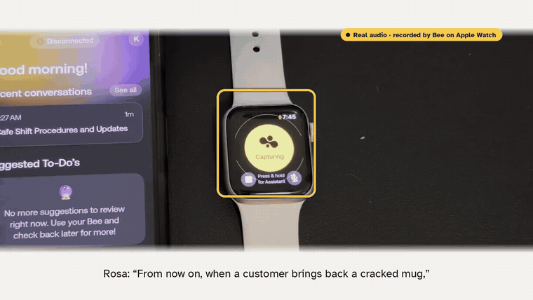
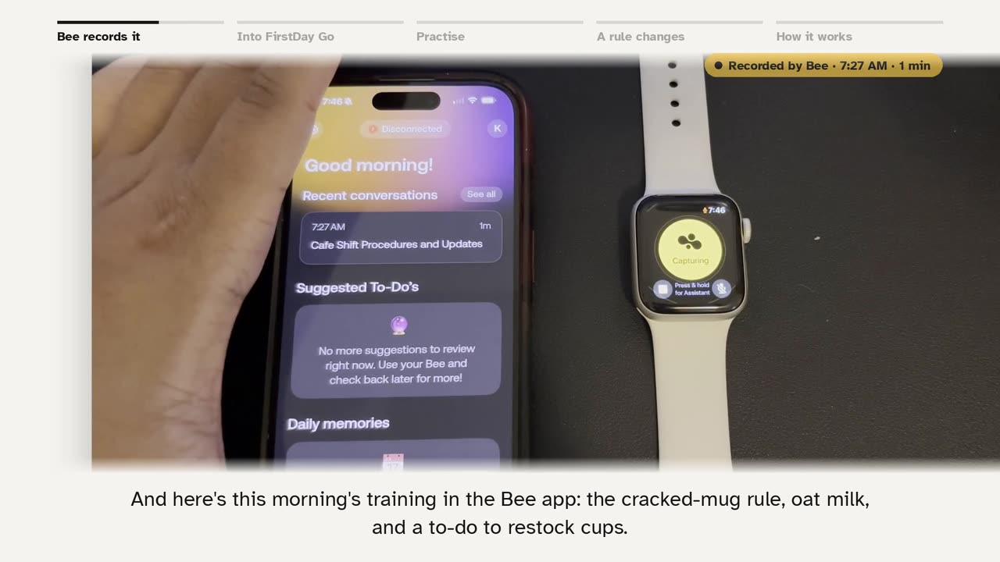
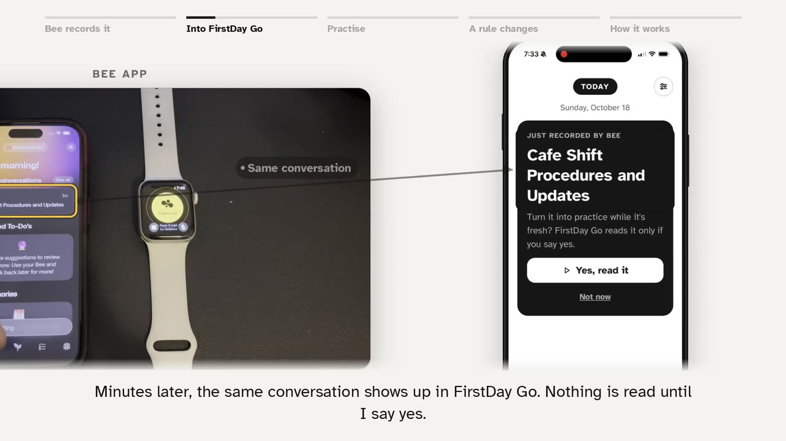
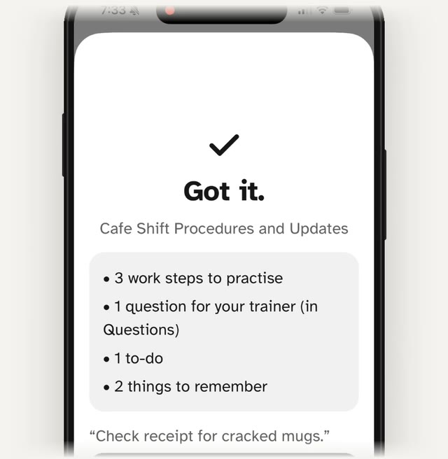
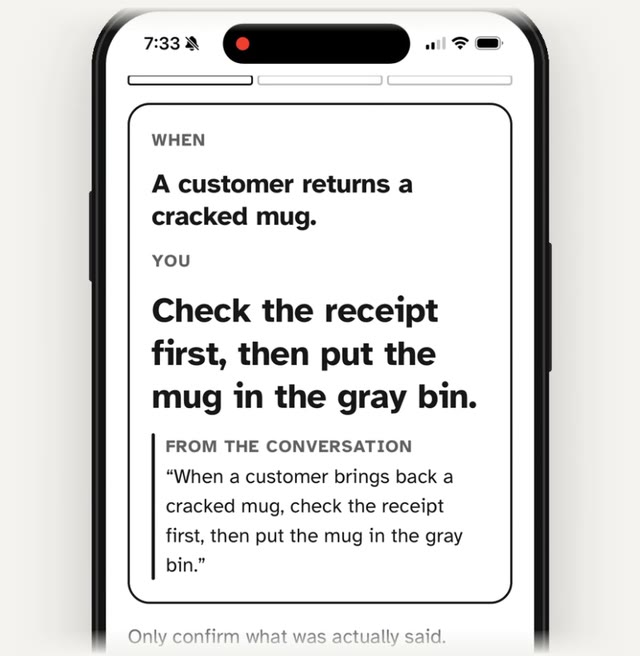
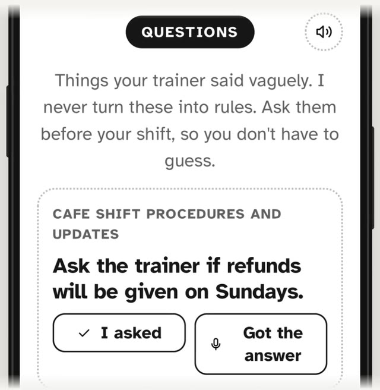
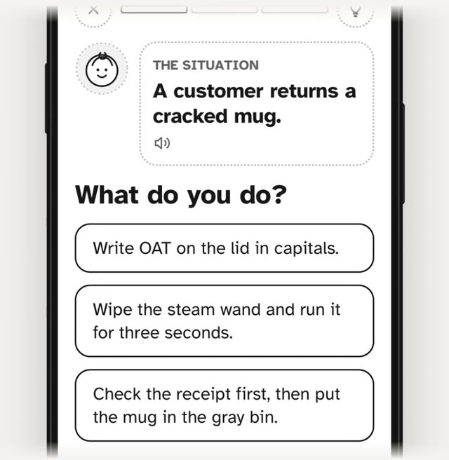
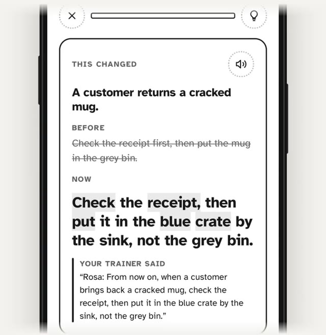

# FirstDay Go

[](https://github.com/foundator779/FirstDay/actions/workflows/firstday-go.yml)

**For the person starting a new job.** With your trainer's OK, Bee hears them. FirstDay Go turns their exact words into
calm, one-step-at-a-time practice for your next shift, built for people with ADHD. Trainers can join in, and a changed
step reaches everyone they've trained.

Bee track · Amazon *Build, Ship, Shape* hackathon 2026 · iPhone (Expo Go) and web · MIT license

<!-- When the demo video is public, add its link here:
**[▶ Watch the 3-minute demo](https://www.youtube.com/watch?v=VIDEO_ID)**
-->

<p align="center">
  
</p>
<p align="center"><sub>Real data, no mock-ups: Bee records the training on an Apple Watch, the same conversation arrives in FirstDay Go, Amazon Bedrock finds the steps, and a changed rule becomes a Change Drill.</sub></p>

| Try it | |
| --- | --- |
| **App, no install** | https://d1ypavau8ae868.cloudfront.net → **Create account** (free: email, password, accept the terms, 6-digit code) |
| **Voice coach** | https://d1ypavau8ae868.cloudfront.net/voice.html (make its link in the app: More → Quiz me from other apps) |
| **MCP server** | `https://xexduccr223pex3iuq4lqe5kfe0utyxs.lambda-url.us-east-1.on.aws/mcp` (spec 2025-11-25, Streamable HTTP, key from the app) |
| **Step-by-step testing** | [Testing it as a judge](#testing-it-as-a-judge), just below |

## Testing it as a judge

About 10 minutes, with nothing to install. The app is free, needs no payment, and stays open for judging through the
end of the judging period. It isn't a private site and there's no shared login: you create your own account.

1. **Open the app.** On an iPhone, open **https://d1ypavau8ae868.cloudfront.net** in Safari (or any browser) and tap
   **Create account**: any email you can read, a password, accept the terms, then the 6-digit code from the email.
   Every account is a real Amazon Cognito account; there are no shared or back-door logins. For the team test in
   step 4 you need a second account: the same Gmail address with `+rosa` before the `@` arrives in the same inbox.
2. **Practise, then see a rule change.** Read the three welcome screens, then **Train** → **Try a sample training**.
   Open **Library welcome desk** → **Start** and practise each step once. Back on **Today**, its trainer has "changed" a
   rule: the **Change Drill** shows old vs. new, and the old answer is now a trap choice.
3. **Turn a training conversation into steps.** **Capture** → **Paste a transcript**, paste this, tap **Find the
   steps**, then **Check work steps**:
   ```
   Rosa: When a customer brings back a cracked mug, check the receipt first, then put the mug in the grey bin.
   If someone orders oat milk, write OAT on the lid in capitals.
   Before closing, wipe the steam wand and run it for three seconds.
   Maybe we'll start giving refunds on Sundays too.
   Oh, and can you restock the paper cups by noon tomorrow? My shift ends at four on Fridays.
   ```
   Name the training "Juniper Café" and type **Rosa** under "Who taught you?". Each step sits next to Rosa's exact
   words, and the "maybe" line lands in the **Questions** tab, never as a rule.
   **Train** → your new training → **Start**: try a wrong answer, and the feedback quotes Rosa with no penalty.
4. **A trainer's change reaches the team** (two accounts, two browsers or a private window, about 5 minutes).
   - *Trainer* (the account from step 3): **Train** → **Juniper Café** → **Share with my team**, and note the
     6-character code.
   - *New hire:* **Train** → **Join my team's training** → the code → **Ask to join**. Nothing arrives yet.
   - *Trainer:* the request shows the new hire's verified email → **Let in**.
   - *New hire:* **Check now**. The training arrives in Rosa's words.
   - *Trainer:* **Capture** → **Paste a transcript**:
     `Rosa: From now on, when a customer brings back a cracked mug, check the receipt, then put it in the blue crate by the sink, not the grey bin.`
     → **Check 1 work step** → **Juniper Café** → **Yes, that's what was said** → **Send to my team now**.
   - *New hire:* Today shows "Rosa changed 1 step in Juniper Café" → **See what changed**.
5. **Quiz me anywhere.** **More** → **Quiz me from other apps** → turn it on → **Make a voice screen link**. Open it
   in Chrome, Edge or Safari on a laptop and say "Quiz me before my shift". Or **Make a key for an AI assistant** and
   add the MCP server to one, for example
   `claude mcp add --transport http firstday-coach <url>/mcp --header "Authorization: Bearer <key>"`.
6. **Amazon Bedrock.** **Settings** → **Check it works** says Amazon Bedrock answered.
7. **Real Bee data** needs your own Bee (wearable or Apple Watch) and the Bee CLI on a computer: see
   [Run it locally](#run-it-locally). The demo above uses the no-computer route, which is open only to the owner's
   account until Bee confirms server-side use.


## The problem

A trainer explains twenty small procedures in an hour ("damaged returns go in the grey bin, scan them first, then
tell Sam") and a new hire is expected to remember them. With ADHD, working memory is exactly what gives out, and the
cost is looking incompetent in week one. Bee already hears that conversation; FirstDay Go makes it something you can
practise. You use it yourself, on your own Bee, with your trainer's OK: no employer has to buy anything.

**Why it matters.** First days come around a lot, and they're hardest for the people FirstDay Go is built for:
- 15.5 million U.S. adults have a current ADHD diagnosis ([CDC, 2024](https://www.cdc.gov/mmwr/volumes/73/wr/mm7340a1.htm)).
- Adults with ADHD do worse on *verbal*, not visual, long-term memory ([Skodzik et al., 2017](https://journals.sagepub.com/doi/10.1177/1087054713510561)). Spoken training is the weak channel; steps you see and practise aren't.
- ADHD is linked to 35 days of lost work performance a year ([Kessler et al., 2005](https://hcp.hms.harvard.edu/publication/prevalence-and-effects-adult-attention-deficithyperactivity-disorder-work-performance)), and only 52% of adults with ADHD were employed vs. 72% without ([Biederman et al., 2006](https://scholars.mssm.edu/en/publications/functional-impairments-in-adults-with-self-reports-of-diagnosed-a-2/)).
- Food-service workers quit at 4.2% a month, twice the all-jobs rate, so new first days come constantly ([BLS JOLTS, 2025](https://www.bls.gov/news.release/jolts.t22.htm)). Each replacement costs an employer about $5,475 to hire ([SHRM, 2025](https://www.shrm.org/about/press-room/shrm-releases-2025-benchmarking-reports--how-does-your-organizat)).

## Real Bee data from an Apple Watch

Filmed on October 18, 2026 with a real Bee account on an Apple Watch: no simulator, no sample file.

<table>
  <tr>
    <td width="50%"></td>
    <td width="50%"></td>
  </tr>
  <tr>
    <td><b>1. Bee records the training on the Watch.</b> Bee's app shows it as "Cafe Shift Procedures and Updates", recorded at 7:27 AM.</td>
    <td><b>2. Minutes later it's in FirstDay Go.</b> Bee's own CLI brings it in, with no computer involved. Nothing is read until you tap <b>Yes, read it</b>.</td>
  </tr>
</table>

## What it does

The app has one job, **getting you ready for your next shift**, and shows one next thing at a time.

- **Work steps from real conversations.** Each instruction the trainer gave sits beside their exact words. You confirm it before it becomes practice. Vague lines ("maybe refunds on Sundays") become questions to ask, never rules.
- **Role-play practice.** A line-drawn customer describes a situation; feedback always quotes the trainer. No scores, no streaks to lose. Spaced review brings steps back after 1, 3, 7 and 14 days.
- **Change Drill.** When a rule changes, you see old vs. new and the old answer becomes a trap choice, so the habit actually updates.
- **On your wrist.** FirstDay Go writes a Bee to-do ("Practise Juniper Café before your shift: 3 steps") with Bee's alarm, so it rings on your Apple Watch, and checks it off once you've practised.
- **Your trainer can join in.** A trainer or job coach shares a training with a 6-character code and lets each person in (or turns on **Let anyone with the code in**). When they send a change, everyone who practised the old way gets a Change Drill and a notification.
- **Quiz me anywhere.** Your confirmed steps power a remote MCP server. An Alexa-style voice screen, or any AI assistant that speaks MCP, quizzes you in your trainer's words.
- **Built on Bee's data, under More:** to-dos, memories, Ask, an evening review and patterns, all synced both ways with Bee.

### A look at the app

<table>
  <tr>
    <td width="50%"></td>
    <td width="50%"></td>
  </tr>
  <tr>
    <td><b>Amazon Bedrock reads it.</b> 3 work steps, 1 question for the trainer and 1 to-do, from the real recording.</td>
    <td><b>Every step keeps the trainer's exact words.</b> You confirm each one, so nothing she didn't say becomes a rule.</td>
  </tr>
  <tr>
    <td></td>
    <td></td>
  </tr>
  <tr>
    <td><b>A "maybe" never becomes a rule.</b> It becomes a question to ask before your shift.</td>
    <td><b>Practise before the shift.</b> Short role-plays from the job; feedback quotes the trainer, and a wrong try costs nothing.</td>
  </tr>
  <tr>
    <td colspan="2" align="center"></td>
  </tr>
  <tr>
    <td colspan="2" align="center"><b>When the trainer changes a rule,</b> a Change Drill puts the old rule next to the new one, and the old answer becomes the trap.</td>
  </tr>
</table>

## How it uses Bee

FirstDay Go reads Bee data only through Bee's official **CLI**, from one of two places:

- **Connect Bee, no computer (preview, used in the demo above).** FirstDay's Bee service runs the Bee CLI in AWS
  Lambda for your account. You agree to the terms and approve FirstDay in Bee; your Bee sign-in is sealed with
  AES-256-GCM using a key only your phone holds, and **Disconnect** deletes it. Open to allow-listed accounts while we
  confirm server-side use with Bee. Code: [`expo-go-app/infra/bee-lambda/`](expo-go-app/infra/bee-lambda/).
- **A small helper on your computer** (`expo-go-app/brain/`) runs the signed-in Bee CLI; the phone pairs with it
  using a 6-digit code, and Bee credentials never leave the computer. The CLI calls are in
  [`expo-go-app/brain/bee.mjs`](expo-go-app/brain/bee.mjs).

| Bee CLI | What FirstDay Go does with it |
| --- | --- |
| `bee stream --json` | Live: when Bee finishes processing a conversation, Today shows "Just recorded by Bee" and sends a notification |
| `bee conversations list` / `get --json` | Reads a training conversation, only after the learner OKs it, and finds each work step with its quote |
| `bee facts list` / `confirm` / `update` / `create` / `delete` | Bee facts become memories; confirming, fixing or forgetting one does the same in Bee |
| `bee todos list` / `suggestions` / `create` / `complete` / `accept-suggestion` / `dismiss-suggestion` | Two-way to-dos and suggestions |
| `bee daily list`, `bee insights list` | Bee's daily summary and insights on Today |
| `bee proxy` | Writes user text back to Bee safely on Windows |

**Where the code calls Bee at runtime** (not just named here; both paths are covered by the integration tests):

- [`expo-go-app/brain/bee.mjs`](expo-go-app/brain/bee.mjs): `runBee()` runs the Bee CLI with `execFile`;
  `listConversations()`, `getConversation()` and `syncSnapshot()` read conversations, facts, to-dos, daily summaries and
  insights; `startWatcher()` keeps `bee stream --json` running for live "Just recorded by Bee" events.
- [`expo-go-app/infra/bee-lambda/app.mjs`](expo-go-app/infra/bee-lambda/app.mjs): the no-computer route. It runs
  `bee login --no-wait` to get Bee's approval link, finishes the sign-in once you approve, and then makes the same calls
  through `bee.mjs` inside AWS Lambda.

The `firstday-coach` Agent Skill ([`expo-go-app/skills/firstday-coach/`](expo-go-app/skills/firstday-coach/SKILL.md))
quizzes you from any agent and composes with Bee's own `bee-cli` skill.

## How it's built on AWS

Everything is deployed with CloudFormation from AWS CloudShell, in us-east-1, pay per use.

| Piece | AWS services | Code |
| --- | --- | --- |
| Smarter reading | Lambda Function URL → **Amazon Bedrock** (Nova Pro, Converse API with a forced tool call); about $0.0016 per capture | `expo-go-app/infra/lambda/`, `infra/template.yaml` |
| Accounts | **Amazon Cognito** (email and password, Lite tier); every Lambda checks the access token | `expo-go-app/src/auth.ts`, `brain/cognito.mjs` |
| Team trainings (with join approval), MCP server | Lambda Function URL + **DynamoDB** (on demand) | `expo-go-app/infra/coach-lambda/`, `infra/coach.yaml` |
| Web version and voice screen | **S3** + **CloudFront** | `expo-go-app/infra/web-hosting.yaml`, `public/voice.html` |
| Connect Bee without a computer (preview) | Lambda running the Bee CLI, tokens sealed with AES-GCM | `expo-go-app/infra/bee-lambda/`, `infra/bee-connect.yaml` |

<p align="center"></p>

The templates are in [`expo-go-app/infra/`](expo-go-app/infra/); deploy steps are under [Run it locally](#run-it-locally).

## Run it locally

**You need:** Git, Node.js 22 or newer, and an iPhone with **Expo Go** from the App Store, on the same Wi-Fi as the
computer. Windows, macOS and Linux all work.

1. **Get the code and start the app.**

   ```bash
   git clone https://github.com/foundator779/FirstDay.git
   cd FirstDay/expo-go-app
   npm install
   npx expo install --fix   # matches package versions to the Expo Go on your phone
   npx expo start           # scan the QR code with the iPhone camera
   ```

   If the phone can't reach the computer (office Wi-Fi often blocks it), use `npx expo start --tunnel`.

2. **Sign in.** The Cognito IDs for the hosted service are built in (`.env.example`), so **Create account** works
   straight away. After you sign in, the app also captures, sorts, reminds and trains offline, reading text with
   on-phone rules.

3. **Bring in your Bee (optional).** Install Bee's CLI and sign in (`bee login`, then `bee status`). Then, in a second
   terminal:

   ```bash
   cd FirstDay/expo-go-app
   npm run brain            # prints an address and a 6-digit pairing code
   ```

   On Windows, allow Node through the firewall on **Private networks** when asked. On the phone: **Settings** →
   **Brain** → type the address and code → **Connect**. Then **+** → **From my Bee**, or leave the app open: when Bee
   finishes processing a new conversation, Today shows **Just recorded by Bee**. Bee credentials never leave the
   computer. Optional settings, as environment variables or in `expo-go-app/.env`: `BEE_CLI_PATH` (default `bee`),
   `FIRSTDAY_GO_PORT` and `FIRSTDAY_GO_CODE` (port and a fixed pairing code), and `FIRSTDAY_BEE_LIVE=0` to stop live
   watching.

4. **Check it works.**

   ```bash
   npm test            # 65 logic tests
   npm run test:node   # 39 integration tests: brain + stand-in Bee CLI, Bee service, coach service and MCP server
   npm run typecheck
   npm run eval        # step-finding accuracy (results below)
   ```

5. **Deploy your own AWS stacks (optional).** Each piece is one CloudFormation stack with a one-command script, run
   from AWS CloudShell. Set your own account ID at the top of each script first (they refuse to run in any other
   account), then deploy in this order: `infra/deploy.sh` (Bedrock endpoint), `infra/deploy-coach.sh` (team trainings
   and the MCP server), `infra/deploy-bee.sh` (Connect Bee, with `ALLOWED_EMAIL=you@example.com`) and
   `infra/deploy-web.sh` (the web app). Point the app at your stacks with the `EXPO_PUBLIC_*` values in
   `.env.example`. Everything is pay per use; each script's usage is in the comments at its top.

## How accurate it is

A wrong step is worse than a missing one, because you'd practise the wrong thing. So the eval measures both, plus
whether vague talk ("maybe", "I think") wrongly becomes a rule. It uses 25 fictional training transcripts: a
development set of 15 workplaces that the on-phone rules were tuned on, and a held-out set of 10 new workplaces
written after tuning. A step counts as found when it covers at least 75% of the expected step's key words.

| Reader | Held-out set (new workplaces) | Precision | Recall | Vague lines made into rules | Quotes word for word |
|---|---|---|---|---|---|
| Amazon Bedrock, Nova Pro | 10 workplaces, 27 steps | **95.8%** | **85.2%** | **0 of 4** | 100% |
| On-phone rules (offline) | 10 workplaces, 27 steps | 94.7% | 66.7% | 1 of 4 | 100% |

- **Bedrock generalises much better** at the same precision, so signed-in captures are read by Bedrock. The app
  falls back to on-phone rules offline, and every step is shown with its quote and must be confirmed, because the
  rules miss about a third.
- On the development set the on-phone rules reach 100% precision and 92.1% recall, with no vague line made a rule.
  CI fails if that ever changes. The held-out set is reported, never gated, so it stays honest.
- **Cost and speed:** about 1,114 input and 225 output tokens per capture, 2.7 seconds, about **$0.0016** at Nova
  Pro's launch price. Nothing runs or bills while nobody uses the app.
- Rerun it: `npm run eval` (on-phone, no network) or `node eval/run-bedrock.mjs` (Bedrock, with your AWS CLI
  credentials), in `expo-go-app/`.

## Hackathon submission

Build, Ship, Shape: Amazon Developer Hackathon 2026.

| Rule | Where it's met |
| --- | --- |
| **Track: Bee (Wearable AI)**. Use Bee's CLI, MCP or Agent Skills | Bee's CLI, called at runtime ([How it uses Bee](#how-it-uses-bee)); plus our own `firstday-coach` Agent Skill and MCP server |
| Data from an actual Bee device or an Apple Watch running Bee | A real conversation recorded by Bee on an Apple Watch ([Real Bee data from an Apple Watch](#real-bee-data-from-an-apple-watch)) |
| Using that Bee data to do something for the customer | It becomes confirmed work steps, a question for the trainer, a to-do, practice and a Change Drill ([A look at the app](#a-look-at-the-app)) |
| **Mini challenge: AWS Builder**. AWS services with documented integrations | Bedrock, Lambda, DynamoDB, Cognito, S3, CloudFront and CloudFormation ([How it's built on AWS](#how-its-built-on-aws)) |
| Setup and run instructions | [Run it locally](#run-it-locally) |
| Testing instructions and judge access | [Testing it as a judge](#testing-it-as-a-judge): free, public, your own account |
| Product feedback for each tool | [docs/submission/product-feedback.md](docs/submission/product-feedback.md) |
| Friction log (optional) | [docs/friction-log.md](docs/friction-log.md): task, steps, expected vs. actual, severity, workaround and suggestion for each entry |
| Feature requests (optional) | [docs/submission/feature-requests.md](docs/submission/feature-requests.md): each with why it matters and a priority |
| Open source license | [MIT](LICENSE), shown in the repository's About section |

<!-- Demo video (2:58, public on YouTube): add the link here and at the top once it's uploaded. -->

**Built during the hackathon.** The submission period runs from August 31 to October 23, 2026. Work started on
September 10, 2026, and the first commit is from September 24, 2026. That first version was a native FirstDay app
(`apps/`, `packages/`, `services/`, `supabase/`), kept for reference and not part of this submission. FirstDay Go,
the submitted app in [`expo-go-app/`](expo-go-app/), started on October 3, 2026, and all of it was built during the
submission period: the screens, step extraction, practice and Change Drills, Bee sync, the Bee service, the coach
service and MCP server, the voice screen, the Agent Skill, the CloudFormation stacks, the tests and the eval.

**Third-party software and data.** FirstDay Go uses Bee's CLI, Bee's own software, as Bee documents it, with each
user's own Bee account and their consent; FirstDay Go reads a conversation only after the user says yes. It also
uses Expo and React Native (MIT) and the Atkinson Hyperlegible font (SIL Open Font License). All AWS services run in
our own account. Bee and Apple Watch belong to their makers. FirstDay Go is not an official Bee or Amazon product.

## License

FirstDay Go is released under the [MIT License](LICENSE).
